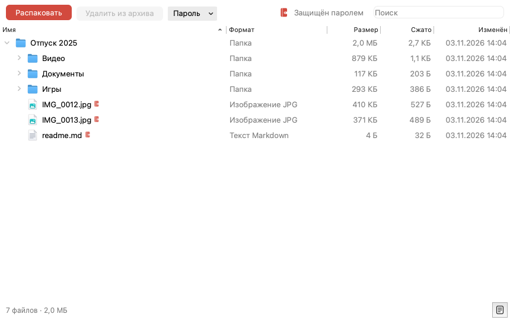
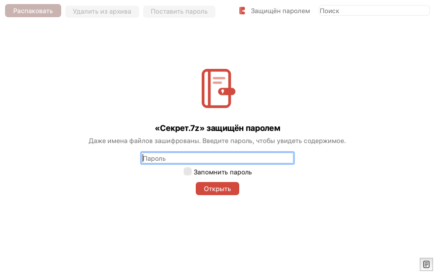
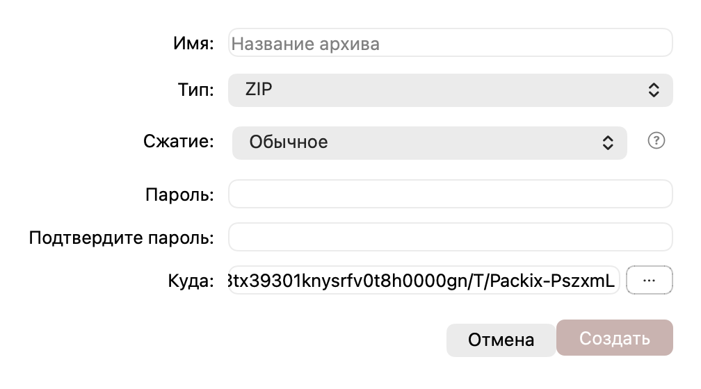
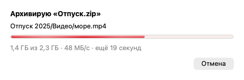
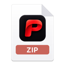
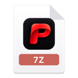

<p align="center">
  
</p>

<h1 align="center">Packix</h1>

<p align="center">
  <b>Красивый и быстрый архиватор для macOS и Windows</b><br>
  zip, 7z, rar, tar и ещё два десятка форматов · архивы с паролем · всё в один клик
</p>

<p align="center">
  
  
  
  
  
  <a href="https://github.com/Bryal52/Packix/releases/latest"></a>
</p>

<p align="center">
  <a href="https://github.com/Bryal52/Packix/releases/latest/download/Packix-1.0.0.dmg"></a>
  &nbsp;
  <a href="https://github.com/Bryal52/Packix/releases/latest/download/Packix-1.0.0-Setup.exe"></a>
</p>

<p align="center">
  <a href="#english">English</a> · <a href="#中文">中文</a>
</p>

<p align="center">
  
</p>

---

## ✨ О программе

Packix живёт в строке меню (на Windows — в трее) и не мешает. Двойной клик по архиву открывает аккуратное окно с его содержимым, а правый клик по файлам в Finder или Проводнике сразу их архивирует. Внутри — проверенный движок 7-Zip, снаружи — родной вид вашей системы с мягкими красными акцентами, светлой и тёмной темой.

## 🚀 Возможности

### 📂 Открывает почти всё
zip, 7z, rar и rar5, tar, gz, bz2, xz, zst, iso, dmg, cab, arj, lzh, wim, cpio, rpm, deb и многотомные архивы (`.001`, `.part1.rar`, `.r00`, `.z01`). Можно открыть любую часть — Packix сам найдёт остальные и заранее скажет, какой не хватает.

### 🔐 Пароли без боли
Архивы с паролем открываются как обычные, даже если зашифрованы сами имена файлов. Пароль можно запомнить — он хранится в Связке ключей macOS или Диспетчере учётных данных Windows и подставляется сам. Поставить, сменить или снять пароль с готового архива — одна кнопка: Packix пересоберёт архив, проверит его и только потом заменит старый.

<p align="center">
  
</p>

### 🗜 «Архивировать» прямо из Finder и Проводника
Выделили файлы → правый клик → «Архивировать». Имя, тип (zip, 7z, tar.gz, tar.xz), степень сжатия, пароль для zip и папка — в одном небольшом окне. Подсказка (?) расскажет, когда сжимать бессмысленно.

<p align="center">
  
</p>

### 🌡 Прогресс как ртутный градусник
Тонкая стеклянная трубка с насыщенно-красной жидкостью, которая переливается, как вода, и плавно течёт вместо рывков. В конце — блик по стеклу и короткая анимация упаковки. Несколько операций могут идти одновременно.

<p align="center">
  
</p>

### 🖱 Всё, что ждёшь от архиватора
- **Перетаскивание:** вытащите файлы из окна в Finder/Проводник — распакуются туда; затащите в окно — добавятся в архив.
- **Превью при наведении** для фото и видео, **Quick Look** по пробелу (macOS).
- **Двойной клик по файлу** открывает его; если вы его изменили — Packix предложит обновить файл в архиве.
- **Архив в архиве** открывается в своём окне, изменения можно сохранить во внешний.
- **Поиск** по архиву, **удаление** файлов, **горячие клавиши** (⌘E, ⌫, ⌘F, Esc).
- **«Файл уже существует»:** Отмена · Оставить оба (`Имя (1).zip`) · Заменить — без случайных потерь.

### 🛡 Бережно и безопасно
Распаковка идёт во временную папку и только потом переносится на место: защита от `../`-путей и опасных ссылок, проверка свободного места до начала, а файлы из скачанных архивов наследуют метку «скачано из интернета» (Gatekeeper / Mark of the Web). Мусор вроде `.DS_Store` и `__MACOSX` в ваши архивы не попадает.

### 🎨 Своё лицо
Иконки архивов в Finder, книжка с застёжкой у защищённых файлов, светящаяся зона для перетаскивания, мягкие анимации (и уважение к настройке «Уменьшить движение»).

<p align="center">
  
  
  
  
</p>

### 🌍 Языки
Русский, English, 简体中文 — переключаются на лету. Свой язык можно добавить без перекомпиляции: скопируйте `ru.json` в папку языков (Настройки → Язык), переведите строки — он сразу появится в списке.

## 📦 Форматы

| | Открыть | Создать | Изменить (удалить / добавить / пароль) |
|---|:---:|:---:|:---:|
| zip | ✅ | ✅ | ✅ |
| 7z | ✅ | ✅ | ✅ |
| tar, tar.gz, tar.xz, tar.bz2 | ✅ | ✅ (tar.gz, tar.xz) | ✅ |
| rar, rar5 | ✅ | — | — (можно пересобрать в zip / 7z с паролем) |
| gz, bz2, xz, zst, iso, dmg, cab, arj, lzh, wim, cpio, rpm, deb | ✅ | — | — |

> Пароль для zip — только латиница, цифры и обычные символы (ограничение формата в 7-Zip). Для пароля на русском выберите 7z.

## 💾 Установка

**macOS 27+ (Apple Silicon):** скачайте `Packix-1.0.0.dmg`, перетащите Packix в «Программы». При первом запуске отметьте «Сделать архиватором по умолчанию» и «Запускать при входе». Пункт «Архивировать» появится в меню Finder: правый клик → Быстрые действия (если его нет — включите в Системные настройки → Клавиатура → Сочетания клавиш → Службы).

**Windows 10 / 11 (x64):** скачайте `Packix-1.0.0-Setup.exe` — права администратора не нужны. Установщик добавит «Архивировать в Packix» в меню Проводника и предложит сделать Packix архиватором по умолчанию. Есть и переносная версия — `Packix-1.0.0-windows-x64-portable.zip`.

## 🛠 Сборка из исходников

```sh
# macOS: Qt 6 и 7-Zip из Homebrew
brew install qt sevenzip
./build.sh            # соберёт Packix.app, установит в /Applications и сделает DMG
```

Windows собирается в GitHub Actions (MSYS2 UCRT64 + Inno Setup), см. [`.github/workflows/windows.yml`](.github/workflows/windows.yml).

Устройство проекта:

```
core/       ядро без интерфейса: движок 7-Zip, безопасная распаковка, многотомные архивы
dialogs/    общие окна и виджеты (их же использует файловый менеджер Folix)
platform/   всё системное: macOS и Windows
app/        само приложение: строка меню / трей, окно архива, настройки
shared/     данные без хардкода: форматы, уровни сжатия, тема, языки
tests/      тесты ядра и интерфейса
```

## 🔗 Родственный проект

[**Folix**](https://github.com/Bryal52/Folix) — двухпанельный файловый менеджер для macOS и Windows. Packix — его красный брат.

## 📜 Лицензии

Packix использует [7-Zip](https://www.7-zip.org) © Igor Pavlov (GNU LGPL + ограничение unRAR: распаковывать RAR можно, создавать — нет). Текст лицензии 7-Zip лежит рядом с программой.

---

## English

**Packix** is a beautiful, fast archiver for macOS and Windows that lives in the menu bar / tray. It opens zip, 7z, rar, tar and two dozen more formats (including multi-part archives), handles password-protected archives (even with encrypted file names), and archives files straight from Finder or File Explorer via the right-click menu. Highlights: a mercury-thermometer progress bar, hover previews, drag in / drag out, nested archives, safe extraction, saved passwords in Keychain / Credential Manager. Interface in Russian, English and Chinese; add your own language by dropping a JSON file into the language folder.

[Download for macOS](https://github.com/Bryal52/Packix/releases/latest/download/Packix-1.0.0.dmg) · [Download for Windows](https://github.com/Bryal52/Packix/releases/latest/download/Packix-1.0.0-Setup.exe)

## 中文

**Packix** 是一款适用于 macOS 和 Windows 的美观、快速的压缩工具，常驻菜单栏 / 系统托盘。支持 zip、7z、rar、tar 等二十多种格式（包括分卷压缩包），可打开带密码的压缩包（连文件名加密的也可以），并能在访达或文件资源管理器中右键直接压缩文件。特色：水银温度计式的进度条、悬停预览、拖入拖出、嵌套压缩包、安全解压、密码保存在钥匙串 / 凭据管理器中。界面支持俄语、英语和简体中文。

[下载 macOS 版](https://github.com/Bryal52/Packix/releases/latest/download/Packix-1.0.0.dmg) · [下载 Windows 版](https://github.com/Bryal52/Packix/releases/latest/download/Packix-1.0.0-Setup.exe)
